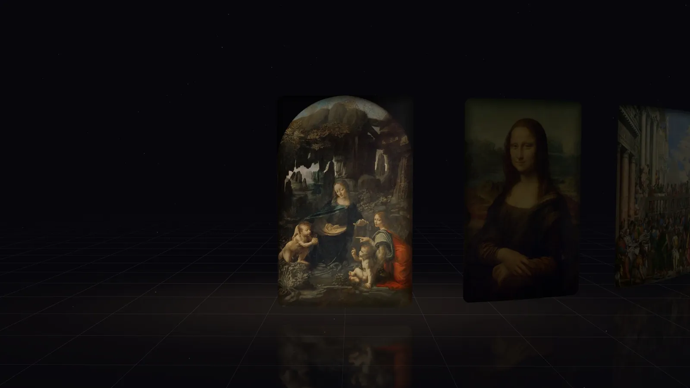

# Landing Page Skill

A reusable workflow for creators building a **single-page portfolio, gallery, product or exhibition site** with Claude Code or Codex. Maintained by **Niki Hu**.

[Read the guide](https://nikihu-a.github.io/landing-page-skill/) · [See the example site](https://nikihu-a.github.io/louvre-after-dark/) · [Install](#install)

[](https://nikihu-a.github.io/louvre-after-dark/)

*Example project: Louvre After Dark. This skill packages the workflow used to build and publish it.*

面向使用 AI 编程助手制作作品集、画廊与产品展示页的创作者。Niki Hu 将实际项目中的方向确认、小样评审、开发、浏览器检查与发布流程整理成可复用的 Skill。

## What it helps you deliver

- A static single-page site published on GitHub Pages.
- A reviewable prototype before the full page is built.
- Browser checks, live-file verification, and guidance for share images and promo videos.

## Typical workflow

**Brief → references and direction → one prototype → build → verify → publish**

The process keeps design decisions visible: agree on the audience and direction, review one piece, then expand it into the full site. Verification covers the local preview and the published files.

For example, ask: **“Make me a one-page portfolio site”** or **“做一个落地页”**. The skill guides the agent through the brief, prototype and publishing steps.

## Origin & maintenance

Niki Hu distilled and maintains this skill from building [**Louvre After Dark**](https://nikihu-a.github.io/louvre-after-dark/) ([source](https://github.com/Nikihu-a/louvre-after-dark)), a 3D single-page gallery of ten Louvre paintings.

The design defaults reflect that project's choices. Use them as a starting point and adapt the brief to each new site.

## What's inside

| Resource | Purpose |
| :--- | :--- |
| `SKILL.md` | The workflow: agree on a direction first, prototype one piece, then build, verify and deploy |
| `references/design-playbook.md` | Design defaults and why: a minimal frame, serif typography, sound off by default, subtle living details |
| `references/tech-recipes.md` | A static stack with no build step, three.js 2.5D depth parallax, Web Audio, colour palettes, loader and performance |
| `references/deploy-github-pages.md` | Publishing with `gh`, polling the Pages build, verifying live files by hash |
| `references/promo-video.md` | Frame-accurate browser capture, ffmpeg, trailer and shorts |
| `references/pitfalls.md` | Bugs encountered in the project and their fixes |
| `scripts/` | A no-cache dev server, a frame recorder (`recorder.py` + `capture.js`), and `verify_deploy.sh` |

Two variants share the same workflow:

- `claude/landing-page/` for **Claude Code**, with Claude Code's preview and file tools.
- `codex/landing-page/` for **OpenAI Codex**, with generic tool wording and `agents/openai.yaml`.

## Install

Claude Code:

```bash
git clone https://github.com/Nikihu-a/landing-page-skill.git
cp -R landing-page-skill/claude/landing-page ~/.claude/skills/
```

OpenAI Codex:

```bash
git clone https://github.com/Nikihu-a/landing-page-skill.git
cp -R landing-page-skill/codex/landing-page ~/.codex/skills/
```

Restart the app or CLI. Then ask for a landing page ("make me a one-page portfolio site", "做一个落地页"). You can also call it by name: `/landing-page` in Claude Code, `$landing-page` in Codex.

## License

MIT © Niki
